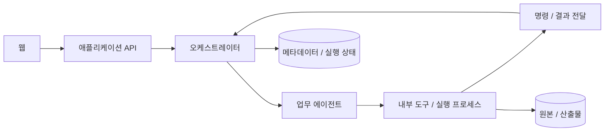

# mideagent 구조

## 목적

현재 실행 책임과 요구사항 사이의 차이를 드러낸다. 목표 구조를 이미 구현된 구조처럼 표시하지 않는다.

## 현재 상태

기준은 `renewal`이며 기존 ‘장면’ 비교 기준 브랜치의 실제 이름은 `master`다. `main`이라는 원격 브랜치는 없다. 현재 코드에는 업무 에이전트, 내부 도구, 모델 역할 프로세스, 메시지 전달·결과 확정 기반이 있다. 새 에이전트 정의와 이전 제어 노드 정의의 결합, 실제 모델 전체 처리는 별도 미완료다.

## 주요 내용

### 현재 소스 책임

- `apps/web/src/`: 작업·원본·workflow 편집·서빙·검수 UI. DEV 목업은 실제 API·실행과 구분한다.
- `apps/api/app/renewal.py`, `renewal_routes/`: 명시적 애플리케이션 factory, 인증과 리소스·작업 API.
- `apps/orchestrator/mideagent_orchestrator/`: 정의 해석, 작업 생성·승인·배정·취소, 결과 수용과 후속 판단. 중심 구현은 `execution.py`에 집중되어 있다.
- `agents/mideagent_agents/`: 업무별 입력·출력·내부 도구 소유권과 다음 도구 결정. 전사·번역의 내부 모델 처리 그래프도 이 계층에 있다.
- `packages/tool-hub/`, `tools/media/`, `tools/models/`, `tools/gpu/`: 도구 계약과 실제 미디어·모델 호출 구현. GPU 기능 중 FaceFusion은 이번 개발 범위 밖이다.
- `runtime/model-executor/`, `runtime/controlnet/`: 실행 프로세스·메시지 소비·수명주기 연결.
- `packages/shared/video_service/`: PostgreSQL, 저장소, 메시지·결과·모델 선택 등 공통 계약. 필요한 이전 import 경계는 호환 모듈로 남아 있다.

화살표는 책임 경계다. 모든 조합의 배포·실제 공급자 처리가 검증됐다는 뜻은 아니다.

### 실제로 남은 결합 문제

- 새 `catalog_version=2`는 업무 에이전트만 받아들이고 공개 카탈로그의 `controls`는 비어 있다. 이전 제어 노드 기반 실행 코드가 남아 있다는 사실만으로 새 업무 에이전트 workflow의 분기·합류·검수·판단이 연결된 것은 아니다.
- 새 정의 검증은 업무에 따라 부모 수를 0 또는 1로 제한한다. 여러 입력의 합류를 현재 지원한다고 표현할 수 없다.
- 저장 자막의 번역 준비 등 일부 독립 업무는 현 작업 계약의 영상 맥락을 요구한다. 불필요한 입력을 강제하지 않는 최종 독립 업무 동선과 구분한다.
- 작업 상태·도구 상태·모델 역할 상태와 여러 snapshot 정책이 함께 존재한다. 기존 결과를 지키는 장치는 보존하되 새 기능마다 다른 준비 경로를 늘리는 방식으로 해결하지 않는다.

### 원자성 경계

PostgreSQL 작업·승인·실행 시도·수용 결과를 트랜잭션과 요청 식별자에 결속한다. 미디어 객체와 메시지 전달은 별도 시스템이므로 검증된 참조·전송 의도·수신 중복 방지·세대 검사를 사용한다. 외부 모델 호출과 과금을 DB 롤백으로 취소할 수 있다고 가정하지 않는다. 자세한 유지 계약은 [실행 계약](../references/high/runtime.md)에 둔다.

## 미확정 사항

최종 VPS/5070 Ti 운영 전환과 자원·인증 설정은 현재 코드 정리와 분리한다. 새 CA 신뢰 교체나 검증 해제, 기존 불명 작업 재실행은 구조 문서만으로 승인되지 않는다.

## 관련 문서

- [제품 요구사항](specs.md)
- [태스크](tasks.md)
- [미확정 기획](ideation.md)
