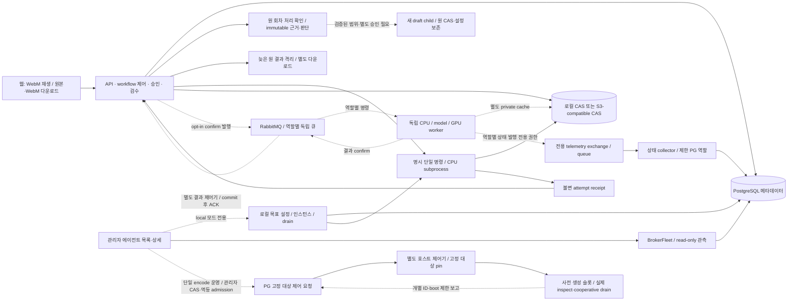

# 미디에이전트 구조

## 목적

현재 구현과 미검증 배포 경계를 거시적으로 관리한다.

## 현재 상태

앱 4개(API·CPU 결과 수신·인코딩 전송 대기·엔진 결과 수신)와 웹은 수용본 `c106bf097d6ea0f84af47590e3d6dd837db944f9`로 운영 반영됐다. DB는 별도 복원/호환성 확인 후 migration018까지 적용했으며 공용 자료함 WIP의 012는 제외했다. 인코딩 호스트 `26710eb0`와 기존 실행기 1개는 그대로다. API는 Docker 권한 없이 PG 요청만 저장하고, 실행 머신의 고정 호스트만 pin/boot/서명 ACK와 실제 상태를 대조한다.

단일 인코딩의 시작·안전한 중지, 실제 작업 완료 후 drain, DB 대기 후 명시 시작·1회 처리는 운영 수용됐다. 명령 TTL은 60초 유지다. 전송 시도는 외부 I/O 전에 별도 commit하고 전용 PG session guard를 유지한다. 전송 결과 불명은 원 시도/요청을 보존한 채 자동 재발행을 막는다. 엔진 결과 수신도 후속 명령을 발행할 수 있어 같은 앱 revision으로 맞춘다.

작업 처리 확인은 native lifecycle 복구와 다른 도메인이다. 원 job/run/outbox/dispatch 사실을 보존한 case·immutable 근거/계획/판단과 DB 쓰기 방어를 둔다. 정확히 단일 encode 노드·모델 binding 없음과 모든 동일 작업 회차/전송의 안전 조건을 확인한다. 종료 근거 부재·미해결 회차/전송·근거 변경은 보류/이전 판단 거부다. 권한·사유·위험 동의·CAS를 통과해도 새 draft만 연결하며 자체 계획/동의/실행 승인이 필요하다. 늦은 원 결과와 파일은 별도 격리해 원 성공이나 child 결과로 섞지 않는다.

실제 관리자 인증 조회와 PC/390px 화면에서 #5의 별도 `needs_review` 표시 및 원 `running` 보존을 확인했다. 판단·계획·새 복구 작업·예약 해제는 0건이며 실제 #5 복구/재발행·초기화는 하지 않았다. 기존 원 자료/키/WIP/롤백과 인코딩 실행기·호스트를 보존했다. 이번에는 동일 영상 여정·운영 장애 주입을 반복하지 않았다.

격리 PG/브라우저·합성 child 및 제어된 저장소/관측 어댑터의 수용은 실제 운영 복구/MQ·물리 실행기 장애 복구와 구분한다. 두 슬롯의 부분 축소/ACK 중단 경계는 격리 수용이며 운영 두 번째 슬롯·여러 컴퓨터 검증은 별도다. 현재 Windows 한 곳의 배치는 검증 배치일 뿐 최종 구조가 아니다. API/웹/DB/저장소/실행 머신의 위치·주소·인증은 독립 설정을 유지한다. 공용 자료 읽기는 아래 별도 소스/격리 설치본 검증까지 진행했으나 운영 반영·원본17개 이관은 남아 있다. 티켓별 저장·일반 provider/동적 폴백·순수 제품 UI 전체와 실제 #5 복구도 별도다.

## 주요 내용

- 공용 입력 호환은 원본 참조를 읽는 모든 설치본의 계약이다. 실제 기존 앱/CPU/model/GPU reader가 새 참조를 거부하므로 앱4·CPU6·model2·GPU2·웹1을 함께 맞춘다. 후보 CPU의 실제 TLS MQ/S3 기존·공용 입력 완료와 후보4군의 S3 읽기/검증을 구분하며, 모델/GPU 전체 추론 재수용으로 확대하지 않는다.
- 현재 고정 호스트는 정확한 container/image/labels와 DB의 단일 group contract를 대조한다. 재생성 target은 기존 등록과 충돌하므로 binary만 새로 설치하거나 host.json/DB 계약을 직접 수정해 교체할 수 없다. 기존 pin·boot·서명 ACK·원 batch/요청 이력을 보존하는 감사된 대상 교체 절차는 별도 gate이며 이번에는 구현·운영 적용하지 않는다.
- 018 상태의 운영 복원본에012를 적용해 기존51개 table의 기존 열 값과 원 #5/snapshot/원본·제어 이력이 보존됨을 확인했다. 새 공용 입력이 생긴 뒤에는 old-reader 거부/옛 owner FK 불일치 때문에 단순 구버전·schema 복귀가 안전하다고 볼 수 없다. 신규 데이터 삭제/owner 재배정 없이 origin-aware 설치본을 유지한 보류·forward fix 또는 별도 승인 복구가 필요하다.

- 공용 읽기는 인증 사용자만 사용하며 자산/작업 ID 중복은 임의 owner를 고르지 않고 거부한다. 공유 응답은 snapshot의 model/engine binding과 원 request/lease 등 private 실행 정보를 제외한다. 처리 확인 projection/전송 phase는 보존하고 UI는 can_manage=true일 때만 본인 작업 변경 동선을 제공한다.
- 새 실행 입력의 source_owner_id는 원본 uploader/CAS를 가리키는 고정 참조다. 결과는 새 실행 actor의 CAS에 저장하고 입력 source owner를 결과에 붙이는 것은 금지한다. migration012는 기존 snapshot의 uploader 또는 기존 owner를 generated asset_owner_id로 읽어 FK를 유지하며 기존 원본 owner와 immutable snapshot을 재작성하지 않는다.
- 공용 읽기 API/실제 설치 CPU와 A/B 브라우저6 및 018→012 호환성은 격리 검증이다. 실제 운영012/기존 원본17개 이관이나 기존 pinned broker worker가 새 입력 origin을 읽는 운영 수용으로 확대하지 않는다. 현재 운영 앱/웹 c106·호스트26710eb0·기존 한 슬롯은 유지한다.

- 후속 격리 경로는 실제 TLS MQ consumer의 개별 ID/권한 보고를 제한 PG host observer가 읽는다. API만 제품 ticket/attempt를 조회해 같은 ID·boot·ticket·attempt일 때 표시 번호를 결합하며 host에는 jobs/password 조회 권한을 주지 않는다.
- 별도 durable batch/action journal은 신호 발행을 planned→issuing→sent로 한 번만 허가하고, 드레인 대기는 fresh Docker 상태·같은 boot의 정상 종료 보고로 따로 확인한다. sent ACK가 있는 중단 요청은 재기동 후 읽기 전용 확인으로 복구하고, ACK가 없는 issuing/unknown이나 비정상 종료는 자동 재시도 없이 봉쇄한다. 관리자 확인은 별도 불변 판단으로 처리하며 근거 없는 unknown은 해제하지 않는다. signal-only 대상은 restart=no를 요구하고 기존 단일 운영 대상의 정책을 유지한다.

- 에이전트는 DB·전체 workflow·다음 노드·웹 세션을 모른다. 애플리케이션이 승인·의존성·검수·취소 generation과 결과 채택을 소유한다.
- S3 경로의 앱과 에이전트는 서로 다른 private cache를 쓴다. 현재 배포의 입력/출력은 owner-scoped digest 참조로 이동하며 ETag를 SHA로 취급하지 않는다. 사용자 확정 목표는 인증 사용자 공용 자료함과 티켓별 object/manifest다. 기존 owner-CAS는 읽기 호환을 보존하고 업로더/실행자는 감사 기록으로 남긴다. credential 저장소를 공용 미디어와 함께 열지 않는다.
- 명령 ID의 DB delivery reservation과 S3 attempt marker가 중복 실행을 막는다. 완료 receipt 없는 예약은 결과 불명이며 자동 재실행하지 않는다.
- 원본·처리 결과와 WebM 파생본의 SHA/출처를 따로 저장한다. GET 재생/다운로드에서 변환하지 않는다. WebM 실패는 원본을 덮어쓰거나 삭제하지 않는다.
- `agents/cpu`는 평탄한 독립 CPU CLI/server/broker 패키지, `agents/gpu`는 선택 FaceFusion/VAD 엔진 패키지다. 구형 media 혼합 패키지·파일 큐·고정 workflow·설정 API·일회성 scripts는 제거했다. GPU 엔진 보존은 실제 MQ 연결이나 hardware 검증 완료가 아니다.
- API import/startup은 migration·queue scan·provider/GPU 작업을 시작하지 않는다. 기존 사설 5174 DEV 목업은 별도다.
- 일반 사용자는 원본·작업만 접근한다. 작업 선택 API는 관리자 정의의 불변 revision을 제공하며 관리 API 권한을 넘기지 않는다. 현재 운영의 원본 owner 격리는 공용 자료함 요구와 아직 다르다. 공용 읽기 소스/격리 설치본은 구현했으며 운영 반영은 별도 검토다. 원본 공유를 credential 소유권 제거로 확대하지 않는다.
- fleet은 관리자 요청 후에만 실제 CPU 프로세스를 만들고, DB 예약으로 역할별 idle 인스턴스 하나에 명시 명령을 배정한다. 설정만 저장된 상태·실제 준비·드레인·실패/불명 상태를 구분하며 시작 시 자동 복구/기동하지 않는다.
- 기본 API 이미지, CPU family 이미지와 선택 GPU 도구 이미지는 레시피를 분리했다. 목적지의 실제 역할별 실행과 단일 encode 고정 호스트 lifecycle은 연결됐다. 다른 역할·다중 슬롯 제어는 별도다. API에 Docker socket을 주지 않는다. API 직접 preview/분석의 FFmpeg 의존성은 잔여다.
- 공통 FFmpeg/FFprobe·폰트는 root Dockerfile의 `media-base` stage 한 곳에서 관리한다. CPU/GPU Dockerfile은 named context로 이를 상속하고 Compose/Bake가 build 의존성을 명시한다. base는 장기 실행하는 공통 서비스가 아니며 역할별 실행은 분리한다. broker SDK와 heavy engine은 선택 layer다.
- 현재 배포의 `--enable-broker`와 private bootstrap은 S3·명시 실행 승인을 전제로 단일 작업 dispatch를 선택한다. API startup 연결/소비는 없고 각 호출이 별도 연결을 소유한다. 결과 소비와 topology 생성은 별도 opt-in CLI다. 별도 상태 collector의 수신 시각으로 worker 준비/처리/heartbeat 만료와 수집기 자체 관측 불가를 구분하며 작업/credential table을 쓰지 않는다. 단일 encode의 고정 호스트 제어는 운영 연결됐으며, 다른 역할·여러 슬롯 운영 제어와 실제 분산 검증은 미완료다. 인스턴스별 상태 인증/binding을 분리하며 단일 exchange의 관측을 복수 인스턴스로 확대하지 않는다.

- MQ req/res 정본은 shared `agent_protocol.py`와 패키지에 포함한 JSON Schema이며 runtime validator가 digest·attempt·정확한 포트까지 검사한다. [wire 계약](../references/high/agent-protocol.md)을 따른다.
- root Compose는 opt-in renewal API/web만 제공한다. provider/model/key의 환경변수 경로는 폐기했으며 private 파일은 DB 접속·listen/origin·스토리지 부팅에만 사용한다. 관리자 DB encrypted credential/revision resolver와 opt-in `infra/compose.yaml` 설치 구성, 별도 `compose.transport.yaml` API/results/operator 연결을 제공한다. 목적지의 실제 broker/S3·독립 CPU/고정 model·PG 제품 job과 GPU 역할 fixture를 수용했다. 공용 읽기 운영 반영·보존 원본 이관·다중 역할/슬롯 fleet 제어·일반 provider 호출·제품 FaceFusion binding은 별도 잔여다.

## 미확정 사항

실제 S3 제품/버전·브로커 topology·VPS/5070 Ti 배포 분할·장시간 WebM 비동기 스케줄링은 운영 승인과 별도 수용 검증이 필요하다.

## 관련 문서

- [기획](specs.md) · [태스크](tasks.md) · [실행 계약](../references/high/runtime.md)
