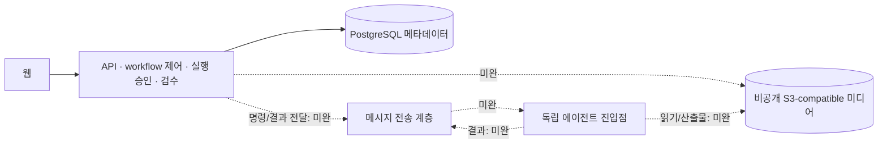

# 미디에이전트 구조

## 목적

현재 실행 구조와 목표 책임 경계를 거시적으로 관리한다.

## 현재 상태

PostgreSQL·비공개 로컬 콘텐츠 저장소·명시 CPU subprocess 경로가 개발 WIP다. 브로커와 S3-compatible 저장소를 통한 독립 배치는 아직 구현·검증 완료가 아니다.

## 주요 내용

### 목표 구조

### 현재 경로와 차이

- `apps/web`은 DEV 목업과 opt-in 실제 API 경로를 구분한다. 상시 사설5174는 목업이며 운영 DB를 쓰지 않는다.
- `apps/api/app/renewal.py`는 명시적인 DB/콘텐츠 저장소를 받아 구성된다. API startup은 migration이나 큐 소비를 하지 않는다.
- `packages/shared/video_service/postgres/`가 원본·정의 revision·티켓 snapshot·승인·노드·검수·복구 상태를 관리한다.
- 현재 CPU 실행은 지정 티켓의 명시 요청에서 subprocess를 호출한다. 독립 CLI가 있다는 사실만으로 브로커 소비·다른 머신에서의 실행 완료를 주장하지 않는다.
- 현재 `ContentStore`는 단일 호스트의 검증된 로컬 비공개 저장소다. 에이전트 간 공유 볼륨을 제거하는 S3 adapter는 남은 작업이다.
- `workers/media`와 `media_worker` 레거시 패키지가 아직 존재한다. `agents` 명칭·패키지·진입점 통합은 확정 후속 작업이며 이 문서 이관으로 이름을 바꾸지는 않았다.
- 기존 운영·legacy 소스와 사용자 데이터는 보존한다. 개발 검증과 실제 GPU/provider/큐/운영 전환을 분리한다.

## 미확정 사항

구체 브로커 topology, S3 서버 제품·버전과 배포 위치는 구현/실행 경계에 맞춰 확인한다. MinIO/RabbitMQ 운영 연결이 이미 끝난 것으로 기록하지 않는다.

## 관련 문서

- [제품 기획](specs.md)
- [확정 태스크](tasks.md)
- [실행 계약](../references/high/runtime.md)
