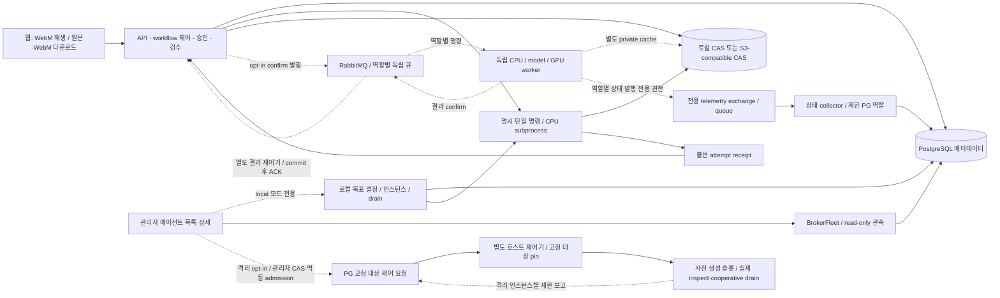

# 미디에이전트 구조

## 목적

현재 구현과 미검증 배포 경계를 거시적으로 관리한다.

## 현재 상태

`23685e3c` 다음 별도 시작/부분 축소 복구는 원 batch의 모든 슬롯 generation 기준선을 host-only로 저장한다(migration016, 기존 행 NULL 보존). 시작 슬롯은 서명 ACK의 실제 StartedAt·현재 보고 boot/pin을 대조하고, 부분 축소의 유지 슬롯도 원 boot/StartedAt/pin과 관측 상태가 유지되는지 검사한다. 결과 개수만 맞는 것은 근거가 아니다. API/host의 기준선 재작성 권한을 추가하지 않으며 기존 계획·action/issue_count·판단 이력을 보존한다. 화면은 신호를 받지 않는 유지 대상과 시작/중지 대상, 현재/ACK 실행 회차의 대조를 구분한다.

격리된 실제 제품 버튼/관리자 복구로 시작 ACK 뒤 SQL 전 중단→읽기/판단 기반 복구, missing ACK·새 실행 회차의 봉쇄, 실제 FFmpeg 작업 중 2→1 축소·제거 대상 drain/exit0·유지 대상 동일 boot의 후속 처리와 화면 결과를 확인했다. 이 경로는 직접 PG 상태 보고와 합성 작업 fixture이며 MQ/제품 티켓·운영 복구 수용은 아니다. 운영 정책/등록/배포/활성화 금지와 restart=no를 유지한다.

관리자 API·호스트는 `07a3caa9012c97876f597605fd27e3755464672f`까지 PM 수용·App push 완료 보고를 받았다. 별도 UI 후속은 기존 fixed-host 실행 설정 아래 recovery status/preview/decision에만 연결한다. 원 요청/pin/boot/예약 기록과 허용 판단을 표시하고, 사유 입력→접수→호스트 재검증 결과/최근 이력을 구분한다. 접수를 성공으로 보거나 파일 근거 부족을 해제하지 않는다. 다른 판단/관측 변경은 이전 계획을 막고 재확인을 요구하며, 늦은 POST와 역순 GET 응답이 이미 확인한 상태를 덮지 않게 한다. 실제 사설 API/PG/native-fault 준비 fixture의 PC/390px 브라우저 자료이며 운영·시작/부분 축소·MQ/티켓 연결 복구 수용은 아니다. Backend 계약/권한·운영 등록/배포/활성화는 변경하지 않는다.

관리자 복구는 `612ce794` 위의 별도 API/host 후속이다. 명시 `create_app(control_recovery=...)`에서 관리자·CSRF preview/decision/status만 추가하며 기본 운영 bootstrap은 그대로다. API는 Docker 대상/명령/ACK 자료나 완료 결과를 제출할 수 없고, 고정 호스트만 서명된 private ACK 파일과 현재 pin/boot/물리 상태를 검증한다. 실제 호출 반환→private ACK 파일→SQL sent의 순서이며 파일조차 없는 모호한 구간은 자동 복구하지 않는다. HMAC 키는 provider 키와 별개이고 이번에는 새 격리 fixture에서만 생성·사용했다.

계획은 원래 요청/계약/대상/boot/action/관측 revision에 묶고 관리자 판단은 불변 intent로 먼저 저장한다. 호스트가 재검증한 관측 확정은 `reviewed_completed`, 비정상 종료는 `reviewed_failed`+격리로 기록한다. 원래 action phase/발행 예약 기록과 제품 작업 결과는 고치지 않으며 복구에서 native 신호를 보내지 않는다. host 검증 때 근거가 바뀌면 `rejected_stale` 이력만 남기고 원래 봉쇄를 유지한다. 실제 제어기 프로세스 중단 두 경계·실제 대상 exit7·제한 DB 권한·API 판단을 일회용 Docker/직접 PG 보고 fixture에서 확인했다. 새 MQ/티켓 수용이나 운영 복구 수용은 아니다. **제품 복구 화면은 위의 별도 UI 후속 검토 범위이며, 근거 없는 unknown 해소·격리 해제/대상 교체와 운영 등록·활성화는 허용하지 않는다.**

현재 웹은 `6eb22e2308cc955f24ebc38614435168d522fe87`, API·에이전트는 `6986b614…`다. 수용/push된 clean archive의 웹만 교체해 실제 PC/모바일 ID 표시, 작업 일반 셀 이동, 처리 에이전트 목록, 원본/산출물 WebM 안내 삭제와 다운로드 링크, 실제 GET 지연 중 상세 스켈레톤을 확인했다. 비웹17개·기존 데이터 mount·bootstrap96파일·WIP·롤백을 보존했다. 제품 제어는 여전히 미연결(`manageable=false`)이며 ID 화면 수용을 다중 실행·start/stop/scale 수용으로 취급하지 않는다. 기존 업로드 수용·격리 API 자동 목록 갱신 수용은 유지하며 이번 배포에서 운영 실패/재개를 다시 시험하지 않았다.

Windows API·에이전트 배포 `6986b614…`에서 PG/S3/TLS RabbitMQ·독립 CPU와 고정 local engine의 합성 영상 제품 job 및 단일 인스턴스별 worker telemetry를 실제 확인했다. 상태 발행 전용 broker 권한과 제한 PG collector를 사용하며 API는 PG의 수신 기록을 읽는다. 기존 controller의 passive 관측403 권한은 넓히지 않았다. 일반 provider·순수 UI 생성·공용 자료함·티켓별 저장·원격 fleet 제어까지 완료된 것은 아니다. 공용 자료함 소스 WIP는 운영 배포에서 제외했다.

별도 opt-in 격리 제어 경로를 추가했다. 제품 관리 API는 관리자·CSRF·멱등 request ID·revision/CAS를 확인해 PG mailbox에 원하는 개수만 저장한다. API와 분리한 호스트 제어기가 사전 고정한 container/image/label/worker ID를 검사하고 실제 관측값을 게시한다. 두 임시 대상의 실제 제품 버튼 0→1→2→1→0, 합성 작업을 유지한 축소와 전체 동시 drain→정상 종료를 검증했다. API DB 역할은 관측/대상 계약/완료 상태 쓰기를 못 하고, 호스트 역할은 제품 job/비밀번호를 읽지 못했다. API에 Docker CLI/socket을 주지 않았다. **이 경로는 운영 bootstrap에 연결하지 않았고 실제 RabbitMQ 다중 인스턴스 제어 수용은 아니다.** 합성 fixture의 PG 작업/산출물은 제품 DAG·티켓/CAS 계약과 분리한다. 소스·격리 결과의 PM 검토 뒤 실제 broker identity/provisioning 및 장시간/결과 불명 정책을 이어가며 운영 `manageable=false`는 유지한다.

## 주요 내용

- 후속 격리 경로는 실제 TLS MQ consumer의 개별 ID/권한 보고를 제한 PG host observer가 읽는다. API만 제품 ticket/attempt를 조회해 같은 ID·boot·ticket·attempt일 때 표시 번호를 결합하며 host에는 jobs/password 조회 권한을 주지 않는다.
- 별도 durable batch/action journal은 신호 발행을 planned→issuing→sent로 한 번만 허가하고, 드레인 대기는 fresh Docker 상태·같은 boot의 정상 종료 보고로 따로 확인한다. sent ACK가 있는 중단 요청은 재기동 후 읽기 전용 확인으로 복구하고, ACK가 없는 issuing/unknown이나 비정상 종료는 자동 재시도 없이 봉쇄한다. 이는 운영자 복구 UI/정책 전체 수용이 아니다. signal-only 방식의 자동 재시작 충돌을 막기 위해 격리 대상의 restart=no를 요구하며 운영 정책은 바꾸지 않았다.

- 에이전트는 DB·전체 workflow·다음 노드·웹 세션을 모른다. 애플리케이션이 승인·의존성·검수·취소 generation과 결과 채택을 소유한다.
- S3 경로의 앱과 에이전트는 서로 다른 private cache를 쓴다. 현재 배포의 입력/출력은 owner-scoped digest 참조로 이동하며 ETag를 SHA로 취급하지 않는다. 사용자 확정 목표는 인증 사용자 공용 자료함과 티켓별 object/manifest다. 기존 owner-CAS는 읽기 호환을 보존하고 업로더/실행자는 감사 기록으로 남긴다. credential 저장소를 공용 미디어와 함께 열지 않는다.
- 명령 ID의 DB delivery reservation과 S3 attempt marker가 중복 실행을 막는다. 완료 receipt 없는 예약은 결과 불명이며 자동 재실행하지 않는다.
- 원본·처리 결과와 WebM 파생본의 SHA/출처를 따로 저장한다. GET 재생/다운로드에서 변환하지 않는다. WebM 실패는 원본을 덮어쓰거나 삭제하지 않는다.
- `agents/cpu`는 평탄한 독립 CPU CLI/server/broker 패키지, `agents/gpu`는 선택 FaceFusion/VAD 엔진 패키지다. 구형 media 혼합 패키지·파일 큐·고정 workflow·설정 API·일회성 scripts는 제거했다. GPU 엔진 보존은 실제 MQ 연결이나 hardware 검증 완료가 아니다.
- API import/startup은 migration·queue scan·provider/GPU 작업을 시작하지 않는다. 기존 사설 5174 DEV 목업은 별도다.
- 일반 사용자는 원본·작업만 접근한다. 작업 선택 API는 관리자 정의의 불변 revision을 제공하며 관리 API 권한을 넘기지 않는다. 현재 배포의 원본 owner 격리는 공용 자료함 요구와 불일치하므로 별도 수정 대상이다. 원본 공유를 credential 소유권 제거로 확대하지 않는다.
- fleet은 관리자 요청 후에만 실제 CPU 프로세스를 만들고, DB 예약으로 역할별 idle 인스턴스 하나에 명시 명령을 배정한다. 설정만 저장된 상태·실제 준비·드레인·실패/불명 상태를 구분하며 시작 시 자동 복구/기동하지 않는다.
- 기본 API 이미지, CPU family 이미지와 선택 GPU 도구 이미지는 레시피를 분리했다. 목적지의 실제 역할별 이미지/컨테이너 실행은 확인했지만 Compose lifecycle은 웹 fleet과 미연결이다. API에 Docker socket을 주지 않는다. API 직접 preview/분석의 FFmpeg 의존성은 잔여다.
- 공통 FFmpeg/FFprobe·폰트는 root Dockerfile의 `media-base` stage 한 곳에서 관리한다. CPU/GPU Dockerfile은 named context로 이를 상속하고 Compose/Bake가 build 의존성을 명시한다. base는 장기 실행하는 공통 서비스가 아니며 역할별 실행은 분리한다. broker SDK와 heavy engine은 선택 layer다.
- 현재 배포의 `--enable-broker`와 private bootstrap은 S3·명시 실행 승인을 전제로 단일 작업 dispatch를 선택한다. API startup 연결/소비는 없고 각 호출이 별도 연결을 소유한다. 결과 소비와 topology 생성은 별도 opt-in CLI다. 별도 상태 collector의 수신 시각으로 worker 준비/처리/heartbeat 만료와 수집기 자체 관측 불가를 구분하며 작업/credential table을 쓰지 않는다. 원격 lifecycle 제어는 미연결이다. 현재 publisher exchange당 고정 worker ID 하나이므로 다중 인스턴스·scale 전에 identity/binding 구조 보완이 필요하다.

- MQ req/res 정본은 shared `agent_protocol.py`와 패키지에 포함한 JSON Schema이며 runtime validator가 digest·attempt·정확한 포트까지 검사한다. [wire 계약](../references/high/agent-protocol.md)을 따른다.
- root Compose는 opt-in renewal API/web만 제공한다. provider/model/key의 환경변수 경로는 폐기했으며 private 파일은 DB 접속·listen/origin·스토리지 부팅에만 사용한다. 관리자 DB encrypted credential/revision resolver와 opt-in `infra/compose.yaml` 설치 구성, 별도 `compose.transport.yaml` API/results/operator 연결을 제공한다. 목적지의 실제 broker/S3·독립 CPU/고정 model·PG 제품 job과 GPU 역할 fixture를 수용했다. 공용 원본 이관·원격 fleet 제어·일반 provider 호출·제품 FaceFusion binding은 별도 잔여다.

## 미확정 사항

실제 S3 제품/버전·브로커 topology·VPS/5070 Ti 배포 분할·장시간 WebM 비동기 스케줄링은 운영 승인과 별도 수용 검증이 필요하다.

## 관련 문서

- [기획](specs.md) · [태스크](tasks.md) · [실행 계약](../references/high/runtime.md)
