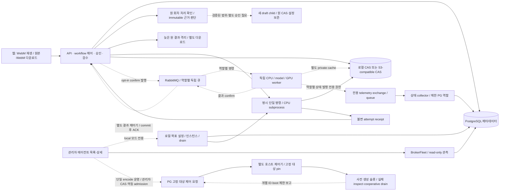
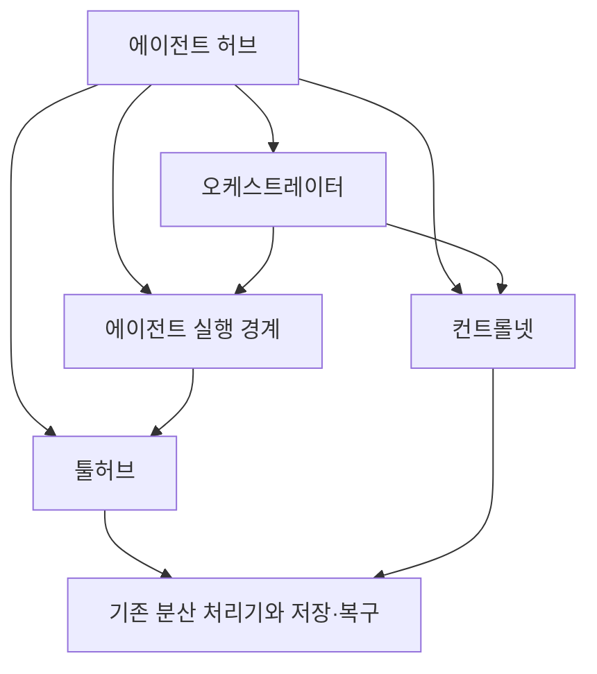

# 미디에이전트 구조

## 확정 추가 범위: 에이전트 전용 워크플로우와 실제 소스 계층

- 만들 것: 전사 → 한국어 번역 → 자막 영상 제작의 업무 에이전트만 저장/편집/실행 캔버스에 둔다. 분석·오디오 준비와 구간 처리는 전사 내부 도구, 자막 생성·번인·검사는 영상 제작 내부 도구다. 오케스트레이터는 에이전트 간 순서·배정·준비를, 에이전트는 자기 도구 선택·순서·결과 확인을 책임진다.
- 사용: 영상과 등록 모델을 고르고 시작한다. 에이전트 상세에서 하위 도구의 진행·출력·실제 콘솔을 본다. 오류는 붉은 노드/이유로, 다음 실행기 실제 준비는 연결선의 ‘다음 단계 준비 중’과 대상 노드의 ‘준비 중’으로 구분한다. 내부 도구 준비는 에이전트 내부 진행이다.
- 소스: 기존 모노레포 안에서 오케스트레이터 구현·업무 agents·tools/툴허브·runtime/컨트롤넷을 실제 이전한다. 기존 import/CLI의 필요한 경계는 구현 없는 호환 모듈로 유지하며 원본 구현을 복제하지 않는다. 패키지·Docker·실행 진입점과 전후 트리를 함께 검증한다.
- 확인 경계: 새 작업·30/31 재실행·실모델/provider·유료/GPU 호출·새 검증계 없이 기존 개발계 빌드/시작과 화면, 네트워크 없는 결정/상태 회귀를 검증한다. 과거 작업 snapshot·실행·결과·불명 원장은 그대로 보존하고 과거 화면의 집계 투영과 새 실제 에이전트 실행 계약을 구분한다.
- 외부 통신: 승인 1565553471640572038의 범위로 전사/번역 연결부만 기존 API 외부망에 연결했다. DNS·인증서 검증 TLS 1.3은 양쪽 성공, HTTP 요청 0, 기존 작업/실행/호출 원장 동일. 이는 전사 완주·품질 검증이 아니다.
- 미검증/미결정: 실영상 새 흐름 완주와 콜드부트 전환의 신규 실행 실증은 승인 범위 밖이다. 없는 과거 HTTP 상태·콘솔을 만들거나 불명 호출을 자동 재호출하지 않는다.

## 최신 정정: 콘솔 원문과 멈춘 작업 표시

로그 탭은 시작·종료 이벤트가 아니라 실행기·모델 연결부의 실제 stdout/stderr와 예외를 보여준다. 태스크별로 구분하고 인증정보를 가린 뒤 컨테이너 밖에 보존한다. 과거에 출력·저장하지 않은 로그는 없다고 표시하며 재실행으로 만들지 않는다. 완료·오류·대기 태스크 모두 출력/로그 탭을 유지한다. 확정 오류와 응답 불명 보류를 작업·태스크 화면에 구분해서 보여주되 원래 실행 기록과 재호출 방지는 보존한다. 시험 작업은 생성 근거로 현재 목록에서만 삭제하고 사용자 작업 20·21·30·31과 불명·감사·결과 기록은 남긴다. 새 시험 작업이나 모델 호출은 하지 않는다.

## 이번 변경의 역할

기존 전사·번역 에이전트와 영상 처리 경로를 재사용한다. 작업·태스크별 저장된 시각과 모델 요청·결과 기록으로 로그를 만들며, 로그 조회는 작업을 실행하거나 다시 요청하지 않는다. 원본·워크플로우의 목록 삭제 상태는 원본 내용·저장된 버전·작업 기록과 분리한다. 원본의 기존 값 변경과 실제 행 삭제는 계속 막고, 삭제 상태는 되돌리지 않는다. 애플리케이션에 새 권한을 부여하지 않는다.

## 무엇을 만드는가

에이전트 허브 안에서 일을 배정하는 역할, 실제 업무를 맡는 에이전트, 에이전트가 쓰는 도구, 필요한 실행기를 켜고 정리하는 역할을 나눈다. 이 구분 때문에 서버를 각각 새로 만드는 것은 아니다.

## 각 역할은 어떻게 일하는가

직접 자막 파일 편집은 기존 로그인·shell 안의 브라우저 기능이다. 파일 읽기·문구/시각 draft·별도 SRT/SMI 다운로드를 클라이언트에서 처리하며 작업·모델·서버 저장 경로와 분리한다. 기존 accepted 파일 읽기의 job/run/포트·인증 결속은 유지한다.

- 오케스트레이터는 에이전트 사이의 작업 순서와 배정, 필요한 처리 용량을 관리한다.
- 전사·번역 에이전트는 자기 업무의 준비·분할·처리·확인·완료를 책임진다.
- 툴허브는 각 에이전트가 사용할 수 있는 도구를 제공한다.
- 컨트롤넷은 필요할 때 실행기를 켜고, 이어지는 작업에 재사용하고, 일이 끝나면 정리한다.

이미 준비된 오디오와 완료된 구간 결과는 다시 만들거나 모델에 다시 요청하지 않고 재사용한다. 응답을 받았는지 확실하지 않은 요청도 자동으로 반복하지 않는다.

## 실제로 확인한 범위

작업 #29에서 전사·번역 에이전트가 준비·모델 호출·결과 확인·합치기 도구를 사용해 결과를 완성했다. 번역 전후에 원문 구간의 식별값·순서·시간이 유지됐고, 처리가 끝난 실행기는 정리됐다. 현재 확인은 기존 개발 환경에서 수행했다.

## 남은 것과 바꾸지 않는 것

여러 컴퓨터에 나눠 배치한 상태와 실제 모델 품질을 이번 결과로 확인했다고 보지 않는다. 기존 작업 순서·저장 자료·권한·비용 제한은 유지한다. 편집기에 도구를 노출하는 결정과 새 범용 자동 계획 기능은 이번 범위에 넣지 않는다.

## 목적

현재 구현과 미검증 배포 경계를 거시적으로 관리한다.

## 현재 상태

전사·번역의 현재 연결과 확인 범위는 위 설명을 따른다. 아래는 그보다 앞선 제어·배포 작업의 기록이며, 당시의 설치 식별자와 미완료 판단을 보존한 것이다. 현재 설치 상태나 새 작업 지시로 읽지 않는다.

### 이전 제어·배포 기록

앱 4개(API·CPU 결과 수신·인코딩 전송 대기·엔진 결과 수신)와 웹은 수용본 `c106bf097d6ea0f84af47590e3d6dd837db944f9`로 운영 반영됐다. DB는 별도 복원/호환성 확인 후 migration018까지 적용했으며 공용 자료함 WIP의 012는 제외했다. 인코딩 호스트 `26710eb0`와 기존 실행기 1개는 그대로다. API는 Docker 권한 없이 PG 요청만 저장하고, 실행 머신의 고정 호스트만 pin/boot/서명 ACK와 실제 상태를 대조한다.

단일 인코딩의 시작·안전한 중지, 실제 작업 완료 후 drain, DB 대기 후 명시 시작·1회 처리는 운영 수용됐다. 명령 TTL은 60초 유지다. 전송 시도는 외부 I/O 전에 별도 commit하고 전용 PG session guard를 유지한다. 전송 결과 불명은 원 시도/요청을 보존한 채 자동 재발행을 막는다. 엔진 결과 수신도 후속 명령을 발행할 수 있어 같은 앱 revision으로 맞춘다.

작업 처리 확인은 native lifecycle 복구와 다른 도메인이다. 원 job/run/outbox/dispatch 사실을 보존한 case·immutable 근거/계획/판단과 DB 쓰기 방어를 둔다. 정확히 단일 encode 노드·모델 binding 없음과 모든 동일 작업 회차/전송의 안전 조건을 확인한다. 종료 근거 부재·미해결 회차/전송·근거 변경은 보류/이전 판단 거부다. 권한·사유·위험 동의·CAS를 통과해도 새 draft만 연결하며 자체 계획/동의/실행 승인이 필요하다. 늦은 원 결과와 파일은 별도 격리해 원 성공이나 child 결과로 섞지 않는다.

실제 관리자 인증 조회와 PC/390px 화면에서 #5의 별도 `needs_review` 표시 및 원 `running` 보존을 확인했다. 판단·계획·새 복구 작업·예약 해제는 0건이며 실제 #5 복구/재발행·초기화는 하지 않았다. 기존 원 자료/키/WIP/롤백과 인코딩 실행기·호스트를 보존했다. 이번에는 동일 영상 여정·운영 장애 주입을 반복하지 않았다.

격리 PG/브라우저·합성 child 및 제어된 저장소/관측 어댑터의 수용은 실제 운영 복구/MQ·물리 실행기 장애 복구와 구분한다. 두 슬롯의 부분 축소/ACK 중단 경계는 격리 수용이며 운영 두 번째 슬롯·여러 컴퓨터 검증은 별도다. 현재 Windows 한 곳의 배치는 검증 배치일 뿐 최종 구조가 아니다. API/웹/DB/저장소/실행 머신의 위치·주소·인증은 독립 설정을 유지한다. 공용 자료 읽기는 아래 별도 소스/격리 설치본 검증까지 진행했으나 운영 반영·원본17개 이관은 남아 있다. 티켓별 저장·일반 provider/동적 폴백·순수 제품 UI 전체와 실제 #5 복구도 별도다.

## 주요 내용

- 유지보수 입장 정책은 기존 HTTPS 뒤의 API 업무 경계이며 별도 ingress/새 관리 API가 아니다. 기동 요구와 bootstrap의 frozen mode/등록 agent·slot/명시 handover phase를 맞추고, 정상 인증을 유지한 채 검토된 auth/관리자 최소 동작 외 모든 HTTP 경로를 body/업무 쓰기 전에 거부한다. 유지보수에서는 미디어 저장소·키/브로커 초기화와 공용 입력/실행 route를 구성하지 않아018에서 먼저 기동할 수 있다. 운영에 설치하지 않았다.
- `handover=false`는019 적용/오류 해소/같은 설정 재시작 뒤에도 그대로이며, `true`는019 catalog와 기존 등록 슬롯을 읽기 전용으로 확인한 명시 재기동에서만 쓴다. API 역할에 migration 이력 읽기나 DDL/포괄 GRANT를 추가하지 않는다. 기존267 host의 Stop0/ACK 뒤019와 새 host CLI를 잇는 격리 설치 경계를 확인했지만 기존 in-flight/별도 결과 수신·DAG 발행 drain은 별도 계약이다.

- 대상 교체 설치 연결은 실제 분리된 최소권한 LOGIN 역할과 수용9ae90c4f의 실제 API/host 진입점으로 격리 검증했다. API는 인증/승인, host는 고정 대상 관측/적용·서명 leaf를 소유한다. exact binding이 없거나 다르면 기동이 막히며, 맞아도 desired0을 유지한다. 같은 별도 DB 복원본의012+019 병합 적용에서도 기존 업무 값·snapshot/#5·제어 이력이 보존됐다. 운영 교체·모델/MQ E2E·실제 여러 컴퓨터 검증을 의미하지 않는다.

- 논리 슬롯1의 대상 교체는 관리자API의 후보 preview/decision과 별도 host의 prepare/apply를 분리한다. host의 기존 고정 config를 덮어쓰지 않고 exact 후보 manifest와 승인된 active binding을 별도 입력으로 받는다. 기존 계약/요청/ACK/boot는 불변 이력에 남으며 current epoch만 승인된 원자 전환으로 바뀐다.
- offline 전환은 기존 host의 exclusive 소유권과 sender guard를 확보한 뒤 정지/서명 근거를 다시 대조한다. 오래된 host/요청은 contract·epoch·원래 세션으로 fence한다. applying 중단은 held이며 자동 재시작/전환/시작을 하지 않는다. API는 native socket 없이 후보ID·사유·개정만 처리한다. 운영에는 아직 설치하지 않았다.

- 공용 입력 호환은 원본 참조를 읽는 모든 설치본의 계약이다. 실제 기존 앱/CPU/model/GPU reader가 새 참조를 거부하므로 앱4·CPU6·model2·GPU2·웹1을 함께 맞춘다. 후보 CPU의 실제 TLS MQ/S3 기존·공용 입력 완료와 후보4군의 S3 읽기/검증을 구분하며, 모델/GPU 전체 추론 재수용으로 확대하지 않는다.
- 현재 고정 호스트는 정확한 container/image/labels와 DB의 단일 group contract를 대조한다. 재생성 target은 기존 등록과 충돌하므로 binary만 새로 설치하거나 host.json/DB 계약을 직접 수정해 교체할 수 없다. 기존 pin·boot·서명 ACK·원 batch/요청 이력을 보존하는 감사된 대상 교체 절차를019로 구현했으며 PM 검토와 운영 적용은 별도 gate다.
- 018 상태의 운영 복원본에012를 적용해 기존51개 table의 기존 열 값과 원 #5/snapshot/원본·제어 이력이 보존됨을 확인했다. 새 공용 입력이 생긴 뒤에는 old-reader 거부/옛 owner FK 불일치 때문에 단순 구버전·schema 복귀가 안전하다고 볼 수 없다. 신규 데이터 삭제/owner 재배정 없이 origin-aware 설치본을 유지한 보류·forward fix 또는 별도 승인 복구가 필요하다.

- 공용 읽기는 인증 사용자만 사용하며 자산/작업 ID 중복은 임의 owner를 고르지 않고 거부한다. 공유 응답은 snapshot의 model/engine binding과 원 request/lease 등 private 실행 정보를 제외한다. 처리 확인 projection/전송 phase는 보존하고 UI는 can_manage=true일 때만 본인 작업 변경 동선을 제공한다.
- 새 실행 입력의 source_owner_id는 원본 uploader/CAS를 가리키는 고정 참조다. 결과는 새 실행 actor의 CAS에 저장하고 입력 source owner를 결과에 붙이는 것은 금지한다. migration012는 기존 snapshot의 uploader 또는 기존 owner를 generated asset_owner_id로 읽어 FK를 유지하며 기존 원본 owner와 immutable snapshot을 재작성하지 않는다.
- 공용 읽기 API/실제 설치 CPU와 A/B 브라우저6 및 018→012 호환성은 격리 검증이다. 실제 운영012/기존 원본17개 이관이나 기존 pinned broker worker가 새 입력 origin을 읽는 운영 수용으로 확대하지 않는다. 현재 운영 앱/웹 c106·호스트26710eb0·기존 한 슬롯은 유지한다.

- 후속 격리 경로는 실제 TLS MQ consumer의 개별 ID/권한 보고를 제한 PG host observer가 읽는다. API만 제품 ticket/attempt를 조회해 같은 ID·boot·ticket·attempt일 때 표시 번호를 결합하며 host에는 jobs/password 조회 권한을 주지 않는다.
- 별도 durable batch/action journal은 신호 발행을 planned→issuing→sent로 한 번만 허가하고, 드레인 대기는 fresh Docker 상태·같은 boot의 정상 종료 보고로 따로 확인한다. sent ACK가 있는 중단 요청은 재기동 후 읽기 전용 확인으로 복구하고, ACK가 없는 issuing/unknown이나 비정상 종료는 자동 재시도 없이 봉쇄한다. 관리자 확인은 별도 불변 판단으로 처리하며 근거 없는 unknown은 해제하지 않는다. signal-only 대상은 restart=no를 요구하고 기존 단일 운영 대상의 정책을 유지한다.

- 목표 경계: 독립 role agent는 자기 task 입력·LangGraph 상태/체크포인트·모델/도구 호출·결과 검증·취소/실패/보류를 소유하며 전체 workflow/jobs/outbox·웹 세션·다음 agent를 읽거나 갱신하지 않는다. Orchestrator가 전체 순서·승인·검수·작업 취소·결과 채택·다음 agent 배정을 소유한다. 공용 라이브러리 재사용은 이 소유권/배포 경계의 증거가 아니다.
- 현재 운영 상태(전환 전): CPU 역할은 별도 프로세스/컨테이너지만 등록 모델 전사·번역·보컬은 `registered` 큐와 application consumer의 `Execution.execute_command/accept/dispatch`에 묶여 있다. 위 목표가 모델 경로까지 완료되었다고 해석하면 안 된다.
- 전환 중인 전사 조각: `agents/models/src/mideagent_models/`는 실제 LangGraph와 역할 전용 SQLite 상태/체크포인트, 총 호출 예산과 분리된 인스턴스 동시 호출 제어, 자기 명령·취소·결과의 TLS MQ 경계, 임시 scoped S3 자격을 갖는다. 별도 worker의 통제 TLS provider 호출·S3 결과·MQ 반환, 완료 재사용·불명 no-recall·MQ 취소 ACK를 격리 환경에서 검증했다. 이는 현재 운영 승격이나 실제 모델 품질 수용이 아니다. 전체 workflow 결과 채택·다음 agent 배정은 계속 orchestrator 책임이며, 그 연결 및 실제 등록 키/모델 grant bridge, 번역·보컬 분리, 검수 OFF와 같은 사이트 다운로드 E2E는 아직 미완료다. 기존/불명 작업을 자동 재실행하지 않는다.
- S3 경로의 앱과 에이전트는 서로 다른 private cache를 쓴다. 현재 배포의 입력/출력은 owner-scoped digest 참조로 이동하며 ETag를 SHA로 취급하지 않는다. 사용자 확정 목표는 인증 사용자 공용 자료함과 티켓별 object/manifest다. 기존 owner-CAS는 읽기 호환을 보존하고 업로더/실행자는 감사 기록으로 남긴다. credential 저장소를 공용 미디어와 함께 열지 않는다.
- 명령 ID의 DB delivery reservation과 S3 attempt marker가 중복 실행을 막는다. 완료 receipt 없는 예약은 결과 불명이며 자동 재실행하지 않는다.
- 원본·처리 결과와 WebM 파생본의 SHA/출처를 따로 저장한다. GET 재생/다운로드에서 변환하지 않는다. WebM 실패는 원본을 덮어쓰거나 삭제하지 않는다.
- `agents/cpu`는 평탄한 독립 CPU CLI/server/broker 패키지, `agents/gpu`는 선택 FaceFusion/VAD 엔진 패키지다. 구형 media 혼합 패키지·파일 큐·고정 workflow·설정 API·일회성 scripts는 제거했다. GPU 엔진 보존은 실제 MQ 연결이나 hardware 검증 완료가 아니다.
- API import/startup은 migration·queue scan·provider/GPU 작업을 시작하지 않는다. 기존 사설 5174 DEV 목업은 별도다.
- 일반 사용자는 원본·작업만 접근한다. 작업 선택 API는 관리자 정의의 불변 revision을 제공하며 관리 API 권한을 넘기지 않는다. 현재 운영의 원본 owner 격리는 공용 자료함 요구와 아직 다르다. 공용 읽기 소스/격리 설치본은 구현했으며 운영 반영은 별도 검토다. 원본 공유를 credential 소유권 제거로 확대하지 않는다.
- fleet은 관리자 요청 후에만 실제 CPU 프로세스를 만들고, DB 예약으로 역할별 idle 인스턴스 하나에 명시 명령을 배정한다. 설정만 저장된 상태·실제 준비·드레인·실패/불명 상태를 구분하며 시작 시 자동 복구/기동하지 않는다.
- 기본 API 이미지, CPU family 이미지와 선택 GPU 도구 이미지는 레시피를 분리했다. 목적지의 실제 역할별 실행과 단일 encode 고정 호스트 lifecycle은 연결됐다. 다른 역할·다중 슬롯 제어는 별도다. API에 Docker socket을 주지 않는다. API 직접 preview/분석의 FFmpeg 의존성은 잔여다.
- 공통 FFmpeg/FFprobe·폰트는 root Dockerfile의 `media-base` stage 한 곳에서 관리한다. CPU/GPU Dockerfile은 named context로 이를 상속하고 Compose/Bake가 build 의존성을 명시한다. base는 장기 실행하는 공통 서비스가 아니며 역할별 실행은 분리한다. broker SDK와 heavy engine은 선택 layer다.
- 현재 배포의 `--enable-broker`와 private bootstrap은 S3·명시 실행 승인을 전제로 단일 작업 dispatch를 선택한다. API startup 연결/소비는 없고 각 호출이 별도 연결을 소유한다. 결과 소비와 topology 생성은 별도 opt-in CLI다. 별도 상태 collector의 수신 시각으로 worker 준비/처리/heartbeat 만료와 수집기 자체 관측 불가를 구분하며 작업/credential table을 쓰지 않는다. 단일 encode의 고정 호스트 제어는 운영 연결됐으며, 다른 역할·여러 슬롯 운영 제어와 실제 분산 검증은 미완료다. 인스턴스별 상태 인증/binding을 분리하며 단일 exchange의 관측을 복수 인스턴스로 확대하지 않는다.

- MQ req/res 정본은 shared `agent_protocol.py`와 패키지에 포함한 JSON Schema이며 runtime validator가 digest·attempt·정확한 포트까지 검사한다. [wire 계약](../references/high/agent-protocol.md)을 따른다.
- root Compose는 opt-in renewal API/web만 제공한다. provider/model/key의 환경변수 경로는 폐기했으며 private 파일은 DB 접속·listen/origin·스토리지 부팅에만 사용한다. 관리자 DB encrypted credential/revision resolver와 opt-in `infra/compose.yaml` 설치 구성, 별도 `compose.transport.yaml` API/results/operator 연결을 제공한다. 목적지의 실제 broker/S3·독립 CPU/고정 model·PG 제품 job과 GPU 역할 fixture를 수용했다. 공용 읽기 운영 반영·보존 원본 이관·다중 역할/슬롯 fleet 제어·일반 provider 호출·제품 FaceFusion binding은 별도 잔여다.

## 미확정 사항

실제 S3 제품/버전·브로커 topology·VPS/5070 Ti 배포 분할·장시간 WebM 비동기 스케줄링은 운영 승인과 별도 수용 검증이 필요하다.

## 관련 문서

- [기획](specs.md) · [태스크](tasks.md) · [실행 계약](../references/high/runtime.md)

## 구현 근거 (개발 참고)

### 도구 연결 방식

LangGraph와 기존 CPU/큐/저장/복구/수명주기를 유지한다. 에이전트-facing 호출은 등록 실행기에 바인딩된 LangChain StructuredTool/BaseTool 및 Pydantic/JSON Schema 입력으로 제공한다. 임시 invoke(identity, request, execute_callback)와 설명 맵은 공개 규격이 아니다. CPU 이미지에는 LLM 프레임워크를 강제하지 않는다. 실제 설치된 langchain-core 1.7.0·Pydantic 2.14.1 조합을 검증하며 설치/업데이트는 수행하지 않는다.

MCP는 외부 런타임 연결이 필요한 경계에 한정한다. 현재 MCP SDK와 langchain 패키지는 설치돼 있지 않으므로 MCP 호환 완료를 주장하지 않으며 독자 MCP/RPC 서버나 새 ingress를 만들지 않는다. 추후 공식 SDK/호환 어댑터의 클라이언트 목록·스키마·호출·결과를 실제 확인한 뒤 판정한다. A2A·새 플랫폼/DSL·워크플로우 노드 노출은 범위 밖이다. 표시명은 '음성 구간 분석'이다. 표준 호출 연결과 자율 선택은 별도다.

### 역할 연결도

허브는 새 상주 서비스가 아니라 공유 SDK·등록/권한 경계와 기존 보호된 조회 API다. 미디어는 기존 역할별 실행기에서 처리한다. 컨트롤넷의 승인 템플릿·기동/재사용/회수와 기존 외부 참조·불명 호출 방지는 유지한다. 고정 실행 경로의 허브 연결과 자율적 도구 선택 능력은 별도로 판정한다. 내부 툴 등록은 캔버스 노드 카탈로그와 분리하며 기존 편집기·저장 정의·작업은 그대로 둔다.

### 이번 작업의 실행 근거

- 개발 환경 작업: #29 (`9d556716cd2143c4b3ac8e86cfb92d62`).
- 실제 실행 코드: `bb6aea65ba0acdd122550c62cc47f5d944586c5c`.
- 역할별 도구 실행·다운로드·보존 확인: 저장소 밖 `task-agent-responsibility/task-agent-result.json`.
- 이 근거는 개발자 확인용이다. 제품 설명이나 새 화면 기능의 요구사항으로 복사하지 않는다.

### 워크플로우 선택 기반 모델 SDK
- 새 일반 작업은 워크플로우 모델 참조와 제한된 `llm_options`를 버전 있는 invocation 계약으로 candidate snapshot에 고정한다. 기존 모델 revision·과거 snapshot은 수정하지 않는다.
- 실제 ASR/MT 툴 경계에서 계정별 키를 일시 해석해 LiteLLM 1.106.6의 요청별 클라이언트로 전달한다. SDK Proxy/Router·새 서비스·SDK 전역 사용자 키는 사용하지 않는다.
- 원래 승인된 origin/TLS/address-pinned transport 앞에서 실제 최종 URL·모델·전송 횟수와 응답 크기를 검사한다. SDK 내부 재시도·다른 모델/주소 전환은 새 유료 전송으로 이어지지 못한다.
- 비용표와 tokenizer 리소스는 image/build 시점에 준비하고 serving 중 자동 취득하지 않는다. SDK 의존성은 모델 툴의 `sdk` extra와 API 구성에 한정한다.
- 과거 invocation 계약이 없는 고정 요청은 호환 경로를 유지한다. 모델 등록/SDK 능력 근거·비용 없는 인자 전달 검증과 실제 공급자 인증/유료 완주는 별개다.
