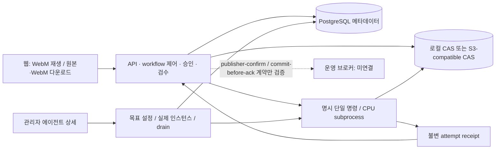

# 미디에이전트 구조

## 목적

현재 구현과 미검증 배포 경계를 거시적으로 관리한다.

## 현재 상태

명시 PostgreSQL·로컬/S3-compatible 콘텐츠 저장소·독립 CPU subprocess·웹 동선과 renewal 관리자 제어를 구현했다. fleet은 로컬 콘텐츠 저장소의 명시 CPU 프로세스만 소유한다. 실제 컨테이너·원격 머신·브로커·MinIO 제품·GPU 연결은 별도 단계다.

## 주요 내용

- 에이전트는 DB·전체 workflow·다음 노드·웹 세션을 모른다. 애플리케이션이 승인·의존성·검수·취소 generation과 결과 채택을 소유한다.
- S3 경로의 앱과 에이전트는 서로 다른 private cache를 쓴다. 입력/출력은 owner-scoped digest 참조로 이동하며 ETag를 SHA로 취급하지 않는다.
- 명령 ID의 DB delivery reservation과 S3 attempt marker가 중복 실행을 막는다. 완료 receipt 없는 예약은 결과 불명이며 자동 재실행하지 않는다.
- 원본·처리 결과와 WebM 파생본의 SHA/출처를 따로 저장한다. GET 재생/다운로드에서 변환하지 않는다. WebM 실패는 원본을 덮어쓰거나 삭제하지 않는다.
- `agents/cpu`는 독립 CPU CLI, `agents/media/media_agent`는 필요한 legacy 호환 코드다. legacy 큐/청소 CLI는 기본 차단하며 compose의 legacy-manual profile도 운영 실행 승인이 아니다.
- API import/startup은 migration·queue scan·provider/GPU 작업을 시작하지 않는다. 기존 사설 5174 DEV 목업은 별도다.
- 일반 사용자는 원본·작업만 접근한다. 작업 선택 API는 관리자 정의의 불변 revision을 제공하되 관리 API 권한이나 원본 소유권을 넘기지 않는다.
- fleet은 관리자 요청 후에만 실제 CPU 프로세스를 만들고, DB 예약으로 역할별 idle 인스턴스 하나에 명시 명령을 배정한다. 설정만 저장된 상태·실제 준비·드레인·실패/불명 상태를 구분하며 시작 시 자동 복구/기동하지 않는다.
- 기본 API 이미지, CPU family 이미지와 선택 legacy media 이미지는 레시피를 분리했다. `agents/cpu/compose.yaml`은 역할별 service/profile 정의이며 웹 fleet과 미연결이다. Docker socket 제어, 이미지 빌드·배포 검증은 수행하지 않았다. API 직접 preview/분석의 FFmpeg 의존성은 잔여다.

## 미확정 사항

실제 S3 제품/버전·브로커 topology·VPS/5070 Ti 배포 분할·장시간 WebM 비동기 스케줄링은 운영 승인과 별도 수용 검증이 필요하다.

## 관련 문서

- [기획](specs.md) · [태스크](tasks.md) · [실행 계약](../references/high/runtime.md)
