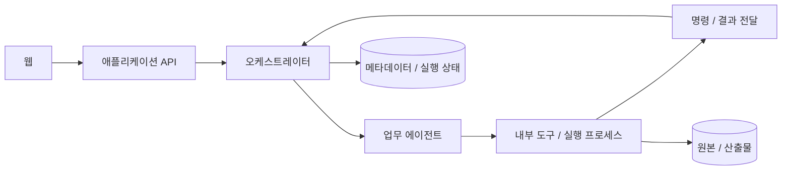

# mideagent 구조

## 목적

현재 실행 책임과 요구사항 사이의 차이를 드러낸다. 목표 구조를 이미 구현된 구조처럼 표시하지 않는다.

## 현재 상태

기준은 `renewal`이며 기존 ‘장면’ 비교 브랜치의 실제 이름은 `master`다. 업무 에이전트의 공개 정의를 기존 durable 도구 그래프로 컴파일하며, 타입 지정 제어·합류·검수와 독립 자막 원본을 연결했다. 격리 제품 실행과 실제 공급자·GPU 컴포넌트는 검증했으나, 운영 브리지 전체 처리와 미연결 제어 유형은 별도 미완료다.

## 주요 내용

### 현재 소스 책임

- `apps/web/src/`: 작업·원본·workflow 편집·서빙·검수 UI. DEV 목업은 실제 API·실행과 구분한다.
- `apps/api/app/renewal.py`, `renewal_routes/`: 명시적 애플리케이션 factory, 인증과 리소스·작업 API.
- `apps/orchestrator/mideagent_orchestrator/`: 정의 해석, 작업 생성·승인·배정·취소, 결과 수용과 후속 판단. 중심 구현은 `execution.py`에 집중되어 있다.
- `agents/mideagent_agents/`: 업무별 입력·출력·내부 도구 소유권과 다음 도구 결정. 전사·번역의 내부 모델 처리 그래프도 이 계층에 있다.
- `packages/tool-hub/`, `tools/media/`, `tools/models/`, `tools/gpu/`: 도구 계약과 실제 미디어·모델 호출 구현. GPU 기능 중 FaceFusion은 이번 개발 범위 밖이다.
- `runtime/model-executor/`, `runtime/controlnet/`: 실행 프로세스·메시지 소비·수명주기 연결.
- `packages/shared/video_service/`: PostgreSQL, 저장소, 메시지·결과·모델 선택 등 공통 계약. 필요한 이전 import 경계는 호환 모듈로 남아 있다.

화살표는 책임 경계다. 모든 조합의 배포·실제 공급자 처리가 검증됐다는 뜻은 아니다.

### 공개 정의와 실행 그래프

- `workflow_controls.py`가 새 `catalog_version=2`의 타입 지정 에이전트·제어 포트를 기존 native 그래프로 컴파일한다. 선택, 합류, 조건 분기, 사람 검수, 자막 트랙과 완료 신호를 지원하며 다중 부모 연결을 입력별로 검증한다.
- 작업에 공개 정의·컴파일 결과·소유권 manifest를 함께 고정한다. 기존 media-only 스냅샷 경로는 유지한다. AI 판단과 아직 연결하지 않은 유형은 지원되는 제어와 구분한다.
- `subtitle_original.py`·`subtitle_import.py`가 기존 원본 등록·CAS에 SRT/단일 언어 SMI를 연결한다. 자막 자체의 원본은 영상 없이 사용할 수 있고, 실제 자막 영상 제작 단계에서만 영상을 요구한다.
- `selected_subtitles` 영상 제작은 검수된 자막 참조를 직접 인코딩한다. 부모 입력의 열거 순서가 자막의 원본 시각 맥락을 덮어쓰지 않는다.
- GPU VAD는 원시 확률과 정확한 디지털 무음의 후처리 확률을 구분해 기록한다. GPU 어댑터가 입력 PCM에서 무음 창을 다시 계산하고 실제 파형과 원본 시각 맵을 검증한다. 낮은 음량을 디지털 무음으로 간주하지 않는다.
- 작업 상태·도구 상태·모델 역할 상태의 확정은 기존 트랜잭션·세대·결과 수용 경계를 따른다. 실제 공급자 시험이나 이 컴파일러의 격리 실행을 운영 전체 배포라고 표현하지 않는다.

### 원자성 경계

PostgreSQL 작업·승인·실행 시도·수용 결과를 트랜잭션과 요청 식별자에 결속한다. 미디어 객체와 메시지 전달은 별도 시스템이므로 검증된 참조·전송 의도·수신 중복 방지·세대 검사를 사용한다. 외부 모델 호출과 과금을 DB 롤백으로 취소할 수 있다고 가정하지 않는다. 자세한 유지 계약은 [실행 계약](../references/high/runtime.md)에 둔다.

## 미확정 사항

최종 VPS/5070 Ti 운영 전환과 자원·인증 설정은 현재 코드 정리와 분리한다. 새 CA 신뢰 교체나 검증 해제, 기존 불명 작업 재실행은 구조 문서만으로 승인되지 않는다.

## 관련 문서

- [제품 요구사항](specs.md)
- [태스크](tasks.md)
- [미확정 기획](ideation.md)
