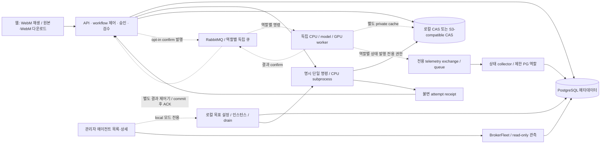

# 미디에이전트 구조

## 목적

현재 구현과 미검증 배포 경계를 거시적으로 관리한다.

## 현재 상태

현재 웹은 `893579340680c8e189fe0d73bfff13943232fae9`, API·에이전트는 `6986b614…`다. 웹만 clean archive로 교체했고 실제 HTTPS PC·모바일 상세와 PC 목록에서 controller의 `확인 불가` 보정을 확인했다. API·에이전트·기존 데이터 mount·키·롤백은 보존했다.

Windows API·에이전트 배포 `6986b614…`에서 PG/S3/TLS RabbitMQ·독립 CPU와 고정 local engine의 합성 영상 제품 job 및 단일 인스턴스별 worker telemetry를 실제 확인했다. 상태 발행 전용 broker 권한과 제한 PG collector를 사용하며 API는 PG의 수신 기록을 읽는다. 기존 controller의 passive 관측403 권한은 넓히지 않았다. 일반 provider·순수 UI 생성·공용 자료함·티켓별 저장·원격 fleet 제어까지 완료된 것은 아니다. 공용 자료함 소스 WIP는 운영 배포에서 제외했다.

## 주요 내용

- 에이전트는 DB·전체 workflow·다음 노드·웹 세션을 모른다. 애플리케이션이 승인·의존성·검수·취소 generation과 결과 채택을 소유한다.
- S3 경로의 앱과 에이전트는 서로 다른 private cache를 쓴다. 현재 배포의 입력/출력은 owner-scoped digest 참조로 이동하며 ETag를 SHA로 취급하지 않는다. 사용자 확정 목표는 인증 사용자 공용 자료함과 티켓별 object/manifest다. 기존 owner-CAS는 읽기 호환을 보존하고 업로더/실행자는 감사 기록으로 남긴다. credential 저장소를 공용 미디어와 함께 열지 않는다.
- 명령 ID의 DB delivery reservation과 S3 attempt marker가 중복 실행을 막는다. 완료 receipt 없는 예약은 결과 불명이며 자동 재실행하지 않는다.
- 원본·처리 결과와 WebM 파생본의 SHA/출처를 따로 저장한다. GET 재생/다운로드에서 변환하지 않는다. WebM 실패는 원본을 덮어쓰거나 삭제하지 않는다.
- `agents/cpu`는 평탄한 독립 CPU CLI/server/broker 패키지, `agents/gpu`는 선택 FaceFusion/VAD 엔진 패키지다. 구형 media 혼합 패키지·파일 큐·고정 workflow·설정 API·일회성 scripts는 제거했다. GPU 엔진 보존은 실제 MQ 연결이나 hardware 검증 완료가 아니다.
- API import/startup은 migration·queue scan·provider/GPU 작업을 시작하지 않는다. 기존 사설 5174 DEV 목업은 별도다.
- 일반 사용자는 원본·작업만 접근한다. 작업 선택 API는 관리자 정의의 불변 revision을 제공하며 관리 API 권한을 넘기지 않는다. 현재 배포의 원본 owner 격리는 공용 자료함 요구와 불일치하므로 별도 수정 대상이다. 원본 공유를 credential 소유권 제거로 확대하지 않는다.
- fleet은 관리자 요청 후에만 실제 CPU 프로세스를 만들고, DB 예약으로 역할별 idle 인스턴스 하나에 명시 명령을 배정한다. 설정만 저장된 상태·실제 준비·드레인·실패/불명 상태를 구분하며 시작 시 자동 복구/기동하지 않는다.
- 기본 API 이미지, CPU family 이미지와 선택 GPU 도구 이미지는 레시피를 분리했다. 목적지의 실제 역할별 이미지/컨테이너 실행은 확인했지만 Compose lifecycle은 웹 fleet과 미연결이다. API에 Docker socket을 주지 않는다. API 직접 preview/분석의 FFmpeg 의존성은 잔여다.
- 공통 FFmpeg/FFprobe·폰트는 root Dockerfile의 `media-base` stage 한 곳에서 관리한다. CPU/GPU Dockerfile은 named context로 이를 상속하고 Compose/Bake가 build 의존성을 명시한다. base는 장기 실행하는 공통 서비스가 아니며 역할별 실행은 분리한다. broker SDK와 heavy engine은 선택 layer다.
- 현재 배포의 `--enable-broker`와 private bootstrap은 S3·명시 실행 승인을 전제로 단일 작업 dispatch를 선택한다. API startup 연결/소비는 없고 각 호출이 별도 연결을 소유한다. 결과 소비와 topology 생성은 별도 opt-in CLI다. 별도 상태 collector의 수신 시각으로 worker 준비/처리/heartbeat 만료와 수집기 자체 관측 불가를 구분하며 작업/credential table을 쓰지 않는다. 원격 lifecycle 제어는 미연결이다. 현재 publisher exchange당 고정 worker ID 하나이므로 다중 인스턴스·scale 전에 identity/binding 구조 보완이 필요하다.

- MQ req/res 정본은 shared `agent_protocol.py`와 패키지에 포함한 JSON Schema이며 runtime validator가 digest·attempt·정확한 포트까지 검사한다. [wire 계약](../references/high/agent-protocol.md)을 따른다.
- root Compose는 opt-in renewal API/web만 제공한다. provider/model/key의 환경변수 경로는 폐기했으며 private 파일은 DB 접속·listen/origin·스토리지 부팅에만 사용한다. 관리자 DB encrypted credential/revision resolver와 opt-in `infra/compose.yaml` 설치 구성, 별도 `compose.transport.yaml` API/results/operator 연결을 제공한다. 목적지의 실제 broker/S3·독립 CPU/고정 model·PG 제품 job과 GPU 역할 fixture를 수용했다. 공용 원본 이관·원격 fleet 제어·일반 provider 호출·제품 FaceFusion binding은 별도 잔여다.

## 미확정 사항

실제 S3 제품/버전·브로커 topology·VPS/5070 Ti 배포 분할·장시간 WebM 비동기 스케줄링은 운영 승인과 별도 수용 검증이 필요하다.

## 관련 문서

- [기획](specs.md) · [태스크](tasks.md) · [실행 계약](../references/high/runtime.md)
